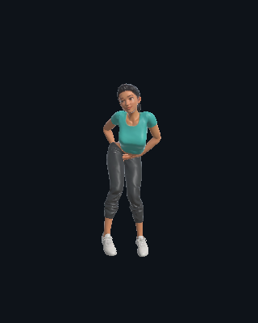
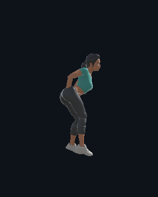

# Snake 手部穿模复查（修复前记录）

> 该问题现已完成修复并恢复八拍编排资格。最新状态与运行验证见 [手臂适配修复](ARM_REPAIR_REVIEW.md)。下文为修复前的诊断与隔离记录。

2026-11-03，在当前 Tripo 人物上复现。单段 Snake 动画就存在问题，不需要动作之间的过渡混合。

沿裁剪区间源动画 5.60–11.23 秒以 30 Hz 采样，检查左右手腕、近似掌心和中指骨骼点相对实际变形后的躯干／大腿上部表面的位置。身体三角形按蒙皮权重筛选，排除手臂自身；同时使用最近表面的法向符号及四个方向的射线奇偶检查。源动画约 **7.67 秒**处，右掌采样点被四个方向都判为身体内侧，距最近身体表面约 8 厘米。这是诊断估计，不是对全部手部网格的精确穿透深度认证。

当前播放程序将 Mixamo Humanoid 动作重定向到 Tripo 人物，处理脚底防穿地，但没有身体体积感知的手臂避让／IK 修正。因此能成功播放、拍点正确、没有运行异常，并不能证明没有手部自穿插。之前的姿态与运行复查漏掉了这一项。

可以确认的是这套人物与动作的适配不合格。当前下载的动作 FBX 没有原人物皮肤，不能据此断言 Mixamo 原角色也穿模，更不能把问题全部归给原动画。后续修正需要检查人物 Avatar 校准、体型和蒙皮，再针对受影响区间调整手与前臂轨迹或采用身体避让 IK。

已撤销 Snake 的动作复查和两条关联连接，并移出 New Jazz 推荐，保留在“全部动作”中预览，名称标记为“待修复”。修复前可编排动作 **7 种**、已复查连接 **8 条**。当时手臂轨迹尚未修复；旧的含 Snake 项目需要重新编排。

复现菜单：`Tools → CHOREO AI → Review → Check Snake hand body intersection`。原始逐帧结果位于 `.generation/snake-hand-body-check/report.json`；摘要见 `HAND_BODY_INTERSECTION_VERIFICATION.json`。
