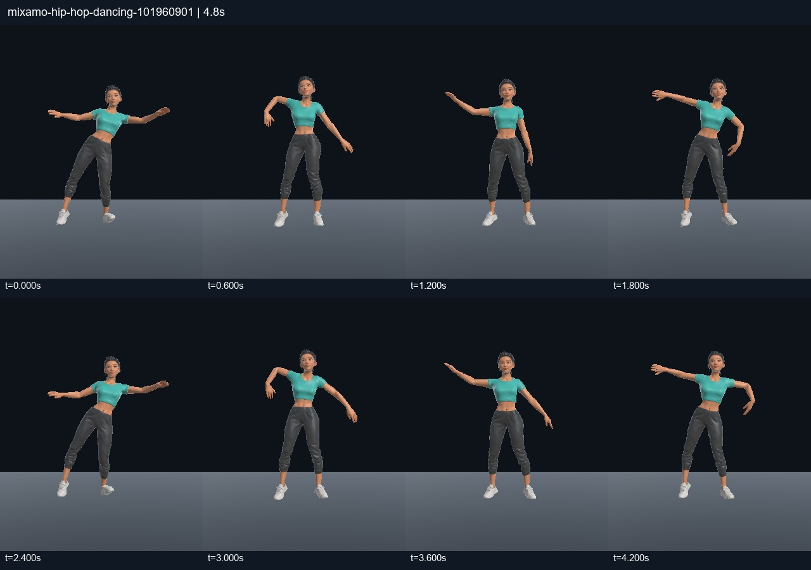
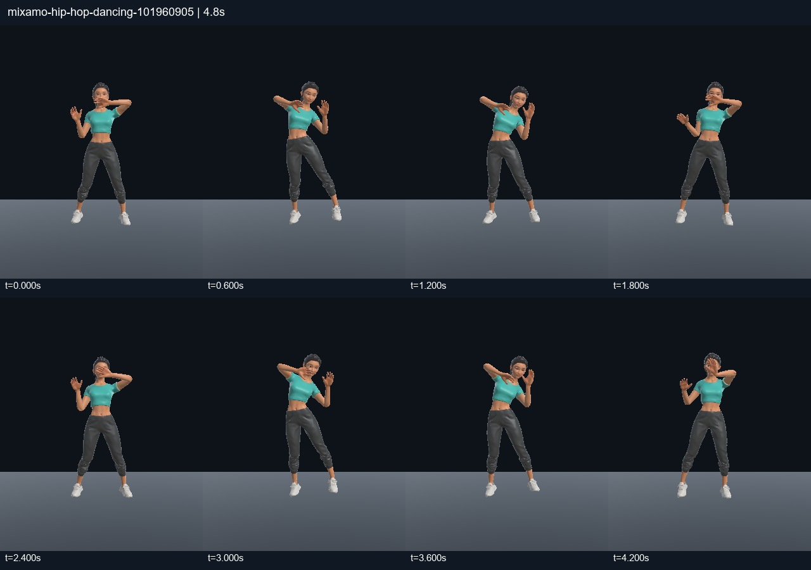
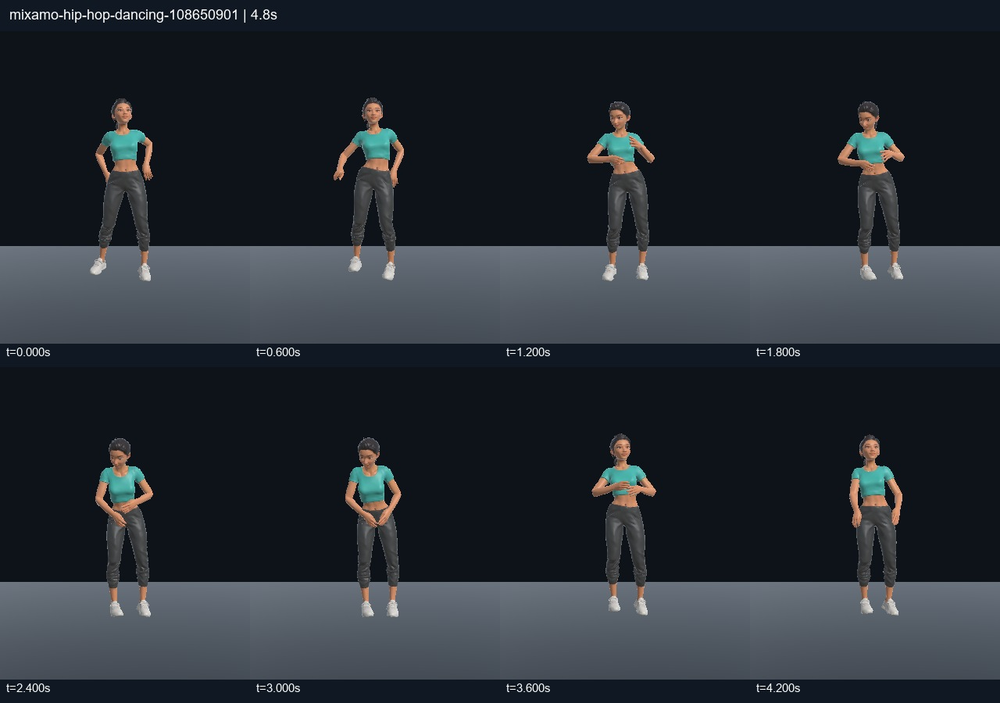
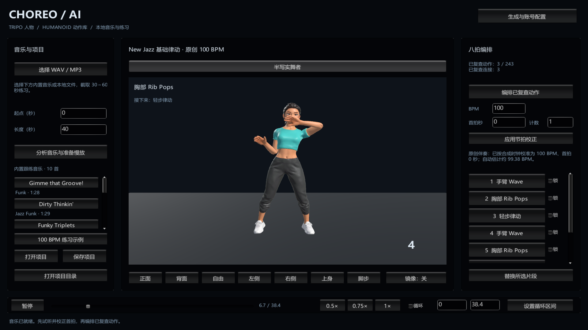

# New Jazz 基础律动 · 100 BPM 验证

> 后续已完成手臂适配修复并重新验收，当前为 **8 种动作、10 条连接**。最新穿模、连续性和 Unity 实播证据见 [手臂修复记录](ARM_REPAIR_REVIEW.md)。下面保留最初三段动作的历史验证。

后续已扩充到 8 种动作并加入动作库设置，见 [最新记录](NEW_JAZZ_EXPANSION_REVIEW.md)。以下保留首轮三段验证。

2026-11-03，在当前 Unity 2022.3.62f3 实例中完成，未打包、未调用付费生成 API。

## 使用

打开 `Assets/Scenes/Studio.unity`，进入 Play Mode，点击左侧 **100 BPM 练习示例**。它会复制原创伴奏到本机项目目录，按当前人物和动作签名生成并保存项目，随后播放。音乐 38.4 秒、64 拍，共 8 个八拍时槽，使用下列 3 个动作轮换；并不是新增了 8 段独立动作。

原始来源均为 Mixamo Hip Hop，定位为可用于 New Jazz 基础练习的 Wave、胸肩重音和轻步律动。这是 Agent 辅助的姿态、节奏和连接复查，未经专业舞蹈教师认证。

## 片段与拍点

拍点数值是源动画中的秒数，共 9 点，最后一点为下一八拍边界。它们经过裁剪和调整，不再使用全片均分的导入草稿。

| 显示名称 | Mixamo 动作 ID | 源动画拍点（秒） |
|---|---|---|
| 手臂 Wave | 101960901 | 0.83, 1.27, 1.70, 2.13, 2.57, 3.00, 3.47, 3.90, 4.33 |
| 胸部 Rib Pops | 101960905 | 0, 0.40, 0.83, 1.27, 1.67, 2.10, 2.50, 2.93, 3.33 |
| 轻步律动 | 108650901 | 6.53, 7.13, 7.77, 8.40, 9.00, 9.57, 10.20, 10.87, 11.47 |

Wave 按下沉／回弹交替计数，Rib Pops 取胸肩律动短句，轻步律动取较连续的身体下沉和重心变化。当前计数是供 100 BPM 练习的适配，并不声称恢复了源动作录制音乐的原始拍号。

三条有向连接为 **Wave → Rib Pops → 轻步律动 → Wave**，均使用一拍、0.6 秒的 SmoothStep 混合；反向连接和任意其他组合没有批准。

## 修复与验证

修复落地检测中的缩放错误：原先默认 `BakeMesh` 后再乘带缩放的世界矩阵，得到错误的网格底部，导致人物被抬高。现在使用 `BakeMesh(mesh, true)`，并按实际变形网格归一到 1.7 米、落地居中。与独立的骨骼矩阵和蒙皮权重计算核对，误差小于 0.000001 米。播放版本升为 3，使旧人物复查自动失效。

编辑器一次调用内采样多帧时，GPU 蒙皮缓存会滞后。离线复查图改为显示当前姿态的 CPU 蒙皮快照；最终运行验证仍使用真实 SkinnedMeshRenderer 和正常 StudioApp 音频加载流程。

- 选中动作均按 30 Hz 测量，并查看正面与侧面姿态。最低膝夹角约 146.9°；这是几何指标，不代表完整关节安全认证。
- 三处连接按 30 Hz 采样，单帧手部位移小于 6.3 厘米、脚部位移小于 5.1 厘米；检查了姿态连续性和地面穿透，未执行完整碰撞或足锁认证。
- Unity Play Mode 完整运行 38.4 秒，覆盖全部 8 个时槽和 3 个动作；随后检查 0.75×、0.5× 及 0.6–1.8 秒短区间循环，共 439 个运行采样，无新增异常。
- 原速音频时间与动作时间之差的 95 分位约 **24.6 毫秒**，最大约 106.7 毫秒。该值包含 Editor／音频缓冲与采样时序差异，不是声卡输出延迟测量。
- 慢放测得时间推进倍率分别为 0.75、0.5；AudioSource.pitch 始终为 1，使用预先伸缩的音频。
- 正常播放采样中实际蒙皮最低点约为地面上 5 毫米；22 项核心检查通过。

机器可读摘要、素材签名、复查说明和音频哈希见 `NEW_JAZZ_100_VERIFICATION.json`。完整逐帧原始记录保存在本机 `.generation/practice-playmode-verification.json`、`.generation/motion-review-100bpm` 和 `.generation/transition-review-100bpm`。

原创音乐使用程序合成鼓、贝斯与和声，生成脚本为 `Tools/make_practice_track.py`，种子 20261103。合成时钟已知 100 BPM、首拍为 0 秒，因此示例使用明确校准的手动拍网；自动检测得到约 99.38 BPM 的结果也保留在分析文件中。

尚未复查其他 BPM、全曲末尾回到开头的接缝、全部候选动作或教学难度。其余 240 个候选仍不进入自动编排。
