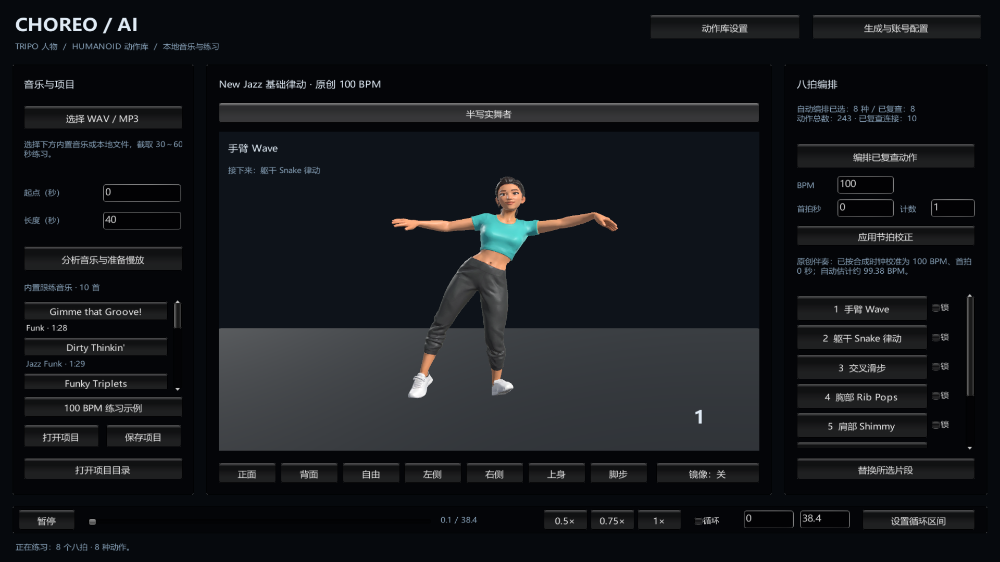
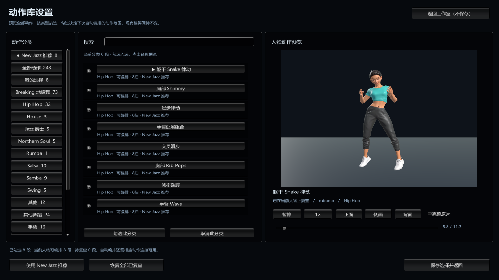

# 动作库设置与 New Jazz 扩充

> 后续已完成 Snake 手臂适配修复和重新验收，当前恢复 **8 种动作、10 条连接**。最新密集穿模、连续性和 Unity 运行证据见 [手臂修复记录](ARM_REPAIR_REVIEW.md)。下面保留初次动作扩充的历史记录。

2026-11-03。当前人物的已复查动作从 3 种扩充到 **8 种**，有向连接从 3 条扩充到 **10 条**。原创 100 BPM、38.4 秒示例现在可以连续使用 8 种不同动作，每种占一个八拍。

## 动作库设置

Unity 首页右上角点击 **动作库设置**：

1. 左侧选择 **New Jazz 推荐**、全部动作、我的选择，或 Hip Hop、Jazz、House 等来源分类。
2. 搜索名称或动作 ID；点击名称，在右侧动态预览当前人物。支持播放／暂停、0.5×、正侧背面、时间轴和完整原片。
3. 勾选参与下次自动编排的动作。也可使用 **勾选此分类**、**取消此分类** 或 **使用 New Jazz 推荐**。
4. 点击 **保存选择并返回**。选择保存在本机；生成编舞和替换片段都会遵守选择，现有项目保持原样。

全部 **243 段**均可浏览预览。列表区分“可编排”和“待复查”：勾选待复查动作会保留选择，实际自动编排仍需要当前人物的动作复查和连接。选择范围过小、连接不足或锁定片段冲突时，生成会说明问题，保留现有编舞。

推荐页使用单独的数据文件 `Assets/Resources/NewJazzRecommendations.json`，保留原始来源分类。Hip Hop 来源不会被改标成专业 New Jazz。

## 本轮新增的五段

| 名称 | 来源动作 ID | 取用源片段（秒） | 练习内容 |
|---|---|---|---|
| 躯干 Snake 律动 | 109070901 | 5.60–11.23 | 躯干前后与侧向隔离 |
| 交叉滑步 | 108870901 | 6.40–10.00 | 交叉、打开与重心切换 |
| 肩部 Shimmy | 108690901 | 0.53–5.33 | 肩部抖动与身体律动 |
| 侧移摆胯 | 108660901 | 5.03–10.07 | 横向步幅、摆胯与开合 |
| 手臂延展组合 | 108990901 | 2.93–8.43 | 手臂伸展、扫动与头部框架 |

保留原有手臂 Wave、胸部 Rib Pops 和轻步律动。本轮从 13 段原片候选中继续筛选；其中 Step 候选持续踮脚的姿态偏夸张，未批准。传统 Jazz 转圈和抬手等其余候选保留待复查。

本轮动作在当前 Tripo 人物上按 30 Hz 采样，查看了裁剪后的正面和侧面姿态；拍点依据源动画的重心、躯干或手臂重音作练习适配，未声称恢复源录制音乐的原始拍号。New Jazz 推荐定位为基础练习适配，未经专业教师认证，未完成完整碰撞或足锁认证。

新增连接为：Wave → Snake → 交叉滑步 → Rib Pops → Shimmy → 侧移摆胯 → 手臂延展 → 轻步律动。保留旧的三条连接；新增的七条均查看正侧面快照和 30 Hz 轨迹，使用一拍、0.6 秒混合。

## 编排与验证

编排原先只惩罚最近四段中的重复，现在还会计算整曲中的动作使用次数，在已复查连接允许时优先覆盖未使用动作。不会为了减少重复而使用未勾选、未复查或没有连接的片段。新增回归检查覆盖旧三段短循环、有选择范围的生成、空选择、待复查选择和锁定片段。

本轮 Unity 整曲实测 8 种动作各出现一次，随后完成 0.75×、0.5× 和短区间循环，共 441 个采样，无新增异常。原速音频时间与动作时间之差的 95 分位约 21.3 毫秒，最大约 85.3 毫秒；这包含 Editor 缓冲和采样时序差异，不是声卡延迟测量。动作库界面的 8 项集成检查通过，28 项核心检查通过。

Unity 运行验证与界面检查的具体结果、序列、拍点、签名及逐阶段时间误差见 `NEW_JAZZ_EXPANSION_VERIFICATION.json`。运行过程直接使用主 Unity 的 Play Mode，没有打包和付费 API 请求。

复现入口：

- `Tools → CHOREO AI → Review → Capture candidates`：读取本机 `.generation/motion-review-plan.json`。
- `Capture practice transitions`：读取 `.generation/transition-review-plan.json`，现在支持任意指定的有向连接。
- `Verify motion library settings`：在 Play Mode 验证动态预览、保存、选择范围和推荐；有原个人设置时会恢复。
- `Verify practice in Play Mode`：通过正常音乐加载入口播放，计划要求至少 8 种不同动作，并检查整曲、慢放和短区间循环。

完整原始证据位于本机 `.generation/newjazz-expansion-*`。其他 BPM、其他候选和整曲循环接缝仍需另行复查。
