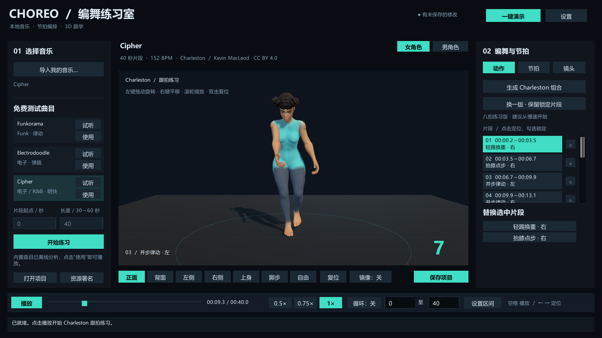

# CHOREO / 编舞练习室 0.5.0

Windows 本地歌曲编舞与跟学应用，采用 **Unity 2022.3.62f3、C#、便携 CPython 3.13.17、librosa 0.11**。

点击“一键演示”即可观看内置 40 秒音乐与真实动捕改编的 **Charleston 八拍练习组合**。包括两个完整蒙皮角色、七种镜头、镜像、三档保留音高慢放、节拍校正、区间循环、替换、锁定和项目恢复。导入 WAV／MP3 无需另装 Python。

公共舞蹈库由四段 CMU Charleston 裁剪及四个左右变体组成，附来源和复查记录。**0.5.0 增加个人学习用的 New Jazz／流行爵士改编接入**：选用 FineDance 真人动捕中原作者标注 `Street / Jazz` 的八个八拍，适配两个角色，复查 20 条连接。数据许可限制第三方分发，因此动作和个人版应用只留在使用者本机，不放进源码或公共下载。[个人学习版准备与许可](Docs/PERSONAL_LEARNING.md)。本版采用动作库和规则编排，没有生成式 AI。

## 运行

从 [公共 Windows 版 0.4.1](https://github.com/KSuperLiu/SongChoreography/releases/tag/v0.4.1) 下载 ZIP，完整解压后双击 `ChoreoStudio.exe`。公共下载展示 Charleston；个人版需按上述说明在本机准备。公共版无需安装 Unity 或 Python。复制公共版时请复制整个目录，保留 `Runtime`、`ChoreoStudio_Data`、`MonoBleedingEdge` 和 DLL。



[快速使用](Docs/QUICK_START.md) · [个人版说明](Docs/PERSONAL_LEARNING.md) · [0.5.0 验证](Docs/NEW_JAZZ_050_VERIFICATION.md) · [公共版验证](Docs/VERIFICATION.md) · [第三方署名](Docs/THIRD_PARTY_NOTICES.md)

项目位于 `%USERPROFILE%\AppData\LocalLow\SongChoreography\Choreo Practice Studio\Projects`，包含普通与慢速音频、节拍、编舞及镜头设置。退出自动保存有效项目，下次启动暂停恢复。移动时复制整个项目目录，再打开 `project.danceproj`。

## 素材与范围

[动作复查](Docs/CHARLESTON_REVIEW.md)记录八个八拍片段与正式使用的 20 条有向连接。批准绑定到曲线 SHA-256；改动后需重新复查。[角色与镜头](Docs/CHARACTERS_AND_CAMERA.md)采用 Quaternius CC0 资源；[音乐](Docs/MUSIC_CREDITS.md)为 Kevin MacLeod 的三首 CC BY 4.0 节选。

技术及 Codex 画面复查不代表舞蹈教师认证。软件时钟误差不包含扬声器硬件延迟。默认面向稳定四拍音乐、30～60 秒片段、单角色；整首歌曲、多舞种、摄像头评分、视频导出、运行时 FBX 导入与生成式动作留待后续。

## 开发与复现

需要 Windows x64、Unity 2022.3.62f3（Windows Build Support），以及用于下载依赖的 Python 3.13 和 pip；运行核心测试另需 .NET 8 SDK。源码仓库包含 CC0 角色、编排代码和动作复查元数据；音乐 PCM、动捕原始数据与转换动画、便携 Python 和构建产物不提交到 Git。首次开发需联网准备素材，成品运行全部离线。

```powershell
git clone https://github.com/KSuperLiu/SongChoreography.git
cd SongChoreography
# 下载官方便携 Python 及锁定的 Windows 依赖；python 应指向本机 Python 3.13。
.\Scripts\prepare-runtime.ps1 -PackagingPython python
# 从原作者下载音乐和选定 CMU 动捕，生成音频、编辑器姿态数据与合成测试音轨。
.\Scripts\prepare-assets.ps1
# 按本机 Unity 安装位置调整路径。首次构建同时烘焙动画及校验复查记录。
.\Scripts\build.ps1 -Isolated -UnityPath 'C:\Program Files\Unity\Hub\Editor\2022.3.62f3\Editor\Unity.exe'

dotnet run --project Tests/CoreTests.csproj -p:UseSharedCompilation=false
.\Runtime\Python\python.exe -I -m unittest discover -s Tests -p test_analyzer.py -v
.\Runtime\Python\python.exe -I -m unittest discover -s Tests -p test_personal_motion.py -v
.\Runtime\Python\python.exe -I Scripts\verify-distribution.py --git-index
.\Scripts\test-portable.ps1 -BuildDirectory Builds\Windows
```

也可在素材准备后，用 Unity Hub 添加仓库根目录，执行菜单 `Tools > Song Choreography > Prepare Prototype`，打开 `Assets/Scenes/Practice.unity` 运行。镜头、角色和编舞界面由运行时代码创建。若下载失败，检查网络后重跑准备命令；脚本保留已下载的文件。上游素材改变后，曲线校验可能拒绝旧批准，应重新复查，不能绕过批准门槛。

隔离构建复用 `.build-cache/UnityProject`，避免占用已打开的 Unity 项目。开发者可在高级设置指定分析器，或用 `SONG_CHOREO_PYTHON` 覆盖；正常使用无需设置。

## 模块接口

音乐分析为独立进程，通过 `schemaVersion: 1` JSON 交换请求、进度和结果；可取消，失败保留原项目。输出三档 PCM WAV、节拍、BPM、强弱和人工校正提示，只解码指定片段。

`MotionCatalog` 记录拍数、强弱、许可、复查及允许后继；`DanceProject` 记录八拍时间槽、种子、锁定、节拍、角色和镜头。动态规划遵守连接和未来锁定，替换不改时长，约束无解保留原序列。

首拍对应计数会设置首段的真实动画相位与长度，再从下一次计数 1 按八拍分组。完整拍组不受自动检测相邻间隔的小幅波动截短；旧项目按已保存序列恢复，重新生成后使用新规则。

公共动作以 DSP 音频时钟采样 Humanoid Playables；个人动捕通过同一时钟驱动两个已验证角色的精确四元数轨道，保留复杂手腕／脚踝姿态。慢速读取离线保留音高音频。动作按已复查的边界混合，并根据实际蒙皮修正接地。未来动作生成可沿用相同的编舞播放接口。

## 开源许可

原创应用代码、脚本和文档采用 [MIT](LICENSE)。Quaternius 角色为 CC0；演示音乐为 Kevin MacLeod 的 CC BY 4.0 作品；CMU 动捕受其原始使用条款约束，未改为 MIT。原创诊断动画及合成节拍夹具为 CC0。Unity、Python 与依赖保留各自条款，详见[第三方说明](Docs/THIRD_PARTY_NOTICES.md)。

CMU ASF／AMC、编辑器姿态数据及烘焙动画不作为独立素材包放入公开源码；开发时由准备脚本下载和转换。发行版中的动作仅随完整练习应用提供。发布修改版时也应保留第三方署名与许可。

FineDance 数据采用作者的非商业科研／教育／艺术用途许可，禁止未经书面许可向第三方提供。`PersonalAssets`、个人动作资产、私人复查画面与包含它们的应用均被排除；公开打包器会拒绝个人版。公开复查清单仅含本项目编写的说明、摘要和连接批准，不含姿态或动画。
