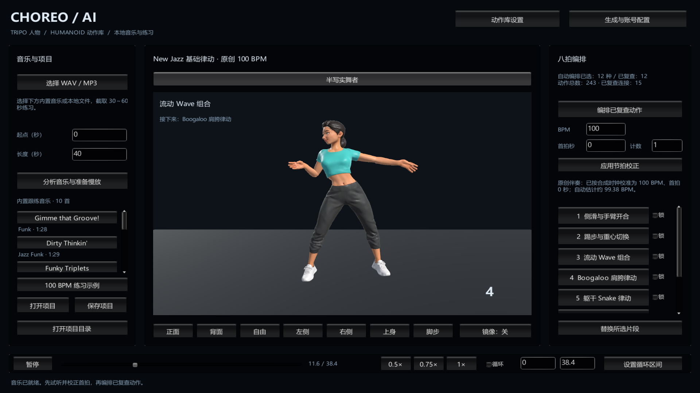

# CHOREO AI Studio · 0.6.0 重构

Unity 2022.3.62f3 / Windows。人物使用 **Tripo**，动作可从 **Mixamo 等已有动作库导入 FBX**，也保留 fal Hunyuan Motion 生成入口。旧 Quaternius 人物、CMU/FineDance 动捕、52 关节专用轨道、固定八段导入器和旧发行流程已移出活动项目。

Windows 发行包内置一个 Tripo 人物及 243 个 Mixamo 候选，按真实来源分类。首页右上角的 **动作库设置** 可预览全部动作、按类型筛选并保存自动编排的选择。当前 **12 种已复查基础动作、15 条有向连接**。原来待适配的 66 段完整原片中，53 段通过本轮技术指标，13 段仍标为待修复，不进入推荐编排。新增侧滑、踢步、流动 Wave 和 Boogaloo。详见 [本轮修复与 Unity 实播记录](Docs/REPAIR66_REVIEW.md)。已有素材不需要 fal Key 或额度。



直接使用：[下载 Windows 成品](https://github.com/KSuperLiu/SongChoreography/releases/latest)。解压整个目录，运行 `ChoreoAIStudio.exe`，点击“100 BPM 练习示例”即可开始。成品包含原创练习伴奏和音乐分析所需的便携 Python，可另外选择自己的 WAV/MP3。

源码仓库包含程序、测试、导入工具、原创练习音频及复查报告；**原始第三方 FBX、生成缓存、API Key 和本机任务历史不上传**。从源码打开时，先导入自己获得授权的模型与动作并完成复查，或直接使用发行包中已编译的完整练习体验。第三方内容不适用本项目代码的 MIT 许可，见 [发行内容与许可说明](THIRD_PARTY_NOTICES.md)。

## 开始

1. 用 Unity Hub 打开本目录（2022.3.62f3）。
2. 打开 **Tools > CHOREO AI > Generation console**。
3. 在官方平台注册 API 账号、查看余额和定价，创建 Key；在窗口的掩码输入框中保存。Key 写入根目录 `.env`，不会放进 Assets、构建或 Git。
4. 人物计划已按用户选择准备：半写实成年女性、自然比例、训练上衣、长裤和运动鞋。先生成一个人物和少量动作候选；不自动批量消费额度。
5. 点击续查。人物依次经过生成、双足检查和骨骼绑定；动作下载 FBX。任务记录保存在 `.generation/jobs`，中断后继续查询。
6. 点击“导入下载结果并打开素材复查”。检查 Unity Humanoid 映射、实际角色播放、每拍拍点及有向连接，填写复查说明。
7. 执行 **Tools > CHOREO AI > Prepare studio**，打开 `Assets/Scenes/Studio.unity` 运行。导入 WAV/MP3，选取 30～60 秒，校正节拍，编排并练习。

生成任务成功和时长匹配不等于舞风或踩拍正确。未复查候选不会进入编排；人物、动画、导入配置或拍点变更后，旧复查自动失效。可以只预览少量候选；动作库不再要求固定八段。

## 使用免费现成动作

1. 在 [Mixamo](https://www.mixamo.com/) 用 Adobe 账号登录，搜索 Dance 并选择动作。先选 3～5 段用于验证；保留动作的真实名称和舞种。
2. 下载设置选择 **FBX for Unity / Without Skin / 30 FPS / Keyframe Reduction: None**。无需把 Tripo 人物上传到 Mixamo；在本地通过 Unity Humanoid 重定向。
3. 停止 Unity Play Mode，打开 **Tools > CHOREO AI > Import motion FBX**。选择下载文件，填写唯一 ID、名称、来源和真实标签，然后导入。
4. 在素材工作台检查 Tripo 人物上的完整动画。首尾拍点用于裁剪一组八拍，中间拍点逐一校正；全片均分的初始拍点只是草稿。
5. 复查关节、接地、穿插和舞风后记录动作复查，再分别检查需要的有向连接。完成后直接在 Unity Play Mode 验证编排和播放。

每个文件复制到 `Assets/Generated/Motions/<id>`，原下载保留。重复 ID 不覆盖；导入失败的 FBX 保留在清单，修复 Rig / Animation 后可在素材工作台重新导入。一个 FBX 含多个动画时，在导入窗口填写精确的 Clip 名。拍点复查同时绑定文件哈希和 Clip 名，更换动画片段后必须重查。

整批下载完成后，执行 `Runtime/Python/python.exe -I -X utf8 Tools/prepare_mixamo_library.py` 可按本地 `.generation/mixamo-batch.json` 批量登记，再在 Unity 执行 **Import generated assets**。登记会核对每个 FBX 的哈希、保留已有条目并避免重复登记，不会自动批准。搜索结果还含 Salsa、Samba、静态姿势和走跑动作，均保留各自分类；不同文件哈希也不代表动作内容一定不同，动作包可能与单条结果重叠。

[Adobe 官方 FAQ](https://helpx.adobe.com/creative-cloud/faq/mixamo-faq.html) 说明免费使用、授权和地区限制；账号无法使用时不要先购买其他服务。其他动作库也可用同一 FBX 入口，记录其各自来源和条款。

## 内置跟练音乐

已下载 10 首 Mixkit 免费音乐，搭配 Funk / Jazz Funk、Hip Hop / R&B 和 House，供个人舞蹈学习使用。Unity 运行界面左侧“内置跟练音乐”中选择曲目，再点击“分析音乐与准备慢放”；默认截取前 40 秒，也可修改起点和 30～60 秒长度。切歌不会覆盖当前编舞，待新音频加载完成后才替换项目。

这些 Mixkit MP3 仅保留在本机，公开发行包使用项目原创 100 BPM 伴奏，不附带这十首原始录音。完整本机曲目与操作见 [内置音乐说明](Docs/MUSIC_LIBRARY.md)。需要恢复本地学习媒体时，运行 `Runtime/Python/python.exe -I -X utf8 Tools/prepare_music_library.py`；脚本保留已下载文件，检查完整解码、时长和哈希，不调用付费接口。

## 网站与配置

- [Tripo API 账号与 Key](https://developers.tripo3d.ai/en/keys)
- [Tripo API 文档](https://developers.tripo3d.ai/en/docs/quick-start)
- [fal 控制台](https://fal.ai/dashboard)
- [Hunyuan Motion 模型与价格](https://fal.ai/models/fal-ai/hunyuan-motion)
- [fal API Key 文档](https://fal.ai/docs/documentation/setting-up/authentication)

API 用量按平台账户结算；网站会员不应默认视为 API 余额。真实 Key 不要发送到聊天。也可以复制 `.env.example` 为 `.env` 后本地填写：

```dotenv
TRIPO_API_KEY=你的Tripo密钥
FAL_KEY=你的fal密钥
```

## 命令行

生成工具只使用 Python 标准库（Python 3.10+）。默认读取根目录 `.env`，环境变量优先。

```powershell
python -X utf8 Tools/generation.py doctor
python -X utf8 Tools/generation.py plan
python -X utf8 Tools/generation.py character dancer-female-v1
python -X utf8 Tools/generation.py motion jazz-side-step-v1
python -X utf8 Tools/generation.py sync all --wait 30
```

已提交的 ID 再次调用只会续查。修改提示词、种子或模型时请用新 ID。若 POST 返回结果前网络中断，不自动重提；从平台控制台找回任务 ID：

```powershell
python -X utf8 Tools/generation.py recover jazz-side-step-v1 generate 平台任务ID
```

人物的阶段也可能是 `rig-check` 或 `rig`。本地查询超时不会取消远端任务，也不会返还额度。生成请求与下载各自保存状态；下载失败可以续传任务流程（重新下载文件，不重复生成）。

## 构建与检查

```powershell
.\Scripts\test.ps1
.\Scripts\build.ps1
.\Scripts\build.ps1 -PublicRelease
.\Scripts\run.ps1
```

构建默认使用 `.build-cache/AIStudioProject` 隔离副本，复用已有本机包，不占用打开的编辑器。普通本机构建输出 `Builds/AIStudio/ChoreoAIStudio.exe`；`-PublicRelease` 输出 `Builds/PublicAIStudio/ChoreoAIStudio.exe`，只在隔离副本中移除本机曲目并加入原创伴奏。本机媒体不变；整个成品目录一起移动。若未准备音乐分析运行时，先运行 `Scripts/prepare-runtime.ps1`。

日常验证直接使用 Unity 编辑器运行；需要交付 Windows 成品时再构建。

生成需要开发环境和网络；打包后使用已导入资源离线练习。成品里的“生成与账号配置”打开本地说明；**FBX 导入和重新打包在 Unity 编辑器执行**，没有声称支持成品运行时导入任意 FBX。支持的练习功能包括镜头、镜像、保留音高慢放、片段锁定、替换、区间循环和新版项目保存。

## 目录

| 目录 | 内容 |
|---|---|
| `Generation/plan.json` | 可编辑人物方案和 12 个不同动作候选 |
| `Tools/generation.py` | Tripo/fal 请求、持久化任务、恢复与下载 |
| `Assets/Generated` | 本机 FBX、贴图与人物预制体，默认不提交 |
| `Generation/library.json` | 下载后的来源、哈希和请求编号 |
| `Generation/reviews.json` | 本机拍点、逐人物动作复查与连接复查 |
| `Assets/SongChoreography/Core` | 素材契约、八拍编排、版本验证 |
| `Assets/SongChoreography/Editor` | 配置、导入、实际动画预览和构建 |
| `Assets/SongChoreography/Runtime` | 新版跟学界面、音乐时钟播放和镜头 |
| `Analyzer` | 本地节拍分析和保留音高慢放 |

重构前的源文件、用户未提交改动和旧本机素材保存在 `.rebuild-backup/legacy-20261103/source-and-assets.zip`，只用于本地恢复，不属于新构建或发布内容。旧版项目不自动迁移为新版。

原创代码采用 MIT；Unity、Python 依赖及生成平台内容分别遵守其条款。不能把“AI 生成”或平台网页标签视为已经完成素材质量和授权确认。
